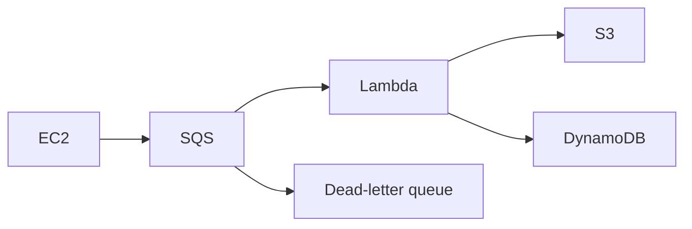

# AWS Audit Pipeline

A defensive AWS lab that triages synthetic authentication events. An EC2 instance sends two sample events to SQS on first boot. Lambda classifies each event, writes a JSON result to S3, and indexes it in DynamoDB.



The EC2 role can send only to the ingest queue. The instance requires IMDSv2 and has no public IP. S3 blocks public access. Lambda reports individual failures so SQS retries only those messages. A retry uses the same SQS message ID as its S3 and DynamoDB keys. The two writes can briefly diverge if the second write fails.

## Run the lab

Install AWS SAM CLI and configure AWS credentials. Pick a subnet with outbound HTTPS access to SQS through a NAT gateway or SQS VPC endpoint. Use a security group in that VPC with no inbound rules and HTTPS egress to the relevant destination.

```bash
sam validate
sam deploy --guided --parameter-overrides Subnet=subnet-EXAMPLE SecurityGroup=sg-EXAMPLE
```

In the stack outputs, find the bucket and table. List the objects and scan the lab table to confirm one `normal` and one `review` result.

```bash
aws s3 ls s3://BUCKET/audit/
aws dynamodb scan --table-name TABLE
```

Resources can incur charges. Empty the archive bucket, then run `sam delete` when finished.
